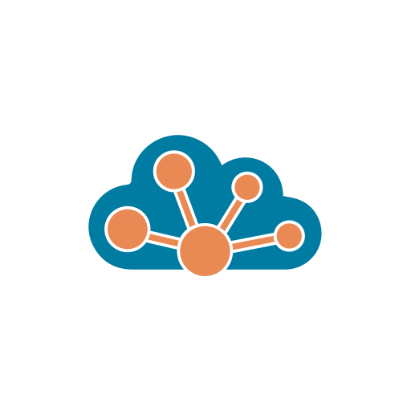

# Cloudillo for Android



[Cloudillo](https://cloudillo.org) is a decentralized collaboration platform (files, documents,
messaging, social) running on a node you own. This is its native Android app: enter your idTag once
(for example `alice.cloudillo.net`) and the app loads your Cloudillo shell (`https://<idTag>/`) live
in a WebView, with native Android integration around it.

## Features

- **Your Cloudillo shell** — login (password, passkey, MFA, IdP) happens in the shell itself. Nothing
  is bundled, so the app always runs your node's current version. The back button walks the history,
  the system bars follow the shell's dark mode, and external links open in your browser.
- **Photo, video and document backup** — enable sources one by one: MediaStore albums for images and
  videos, plus any folder picked with the system folder picker for documents. Each source uses a
  server preset (`default`, `high_quality`, `mobile`, `archive`, `orig-only`) or inherits a global
  default; the phone always uploads the original and the server makes the variants. When enabling a
  source, choose "back up existing" or "only new from now". Backup is one-way and append-only (local
  deletes never propagate); files land in `Phone backup / <device> / <source>`. A SHA-256 precheck
  means a reinstall re-uploads nothing. Configured in the shell's "This device" settings section.
- **Smart background uploads** — new photos are detected instantly via JobScheduler content
  triggers, with a rescan every 6 hours. Large backfills run as user-initiated data-transfer jobs
  (Android 14+) or a foreground service (Android 10–13) and resume after reboots or connection loss.
  Options: mobile data per source (default off), videos only on Wi-Fi (default on), require charging
  (default off); uploads pause on low battery.
- **Notifications without Google** — [UnifiedPush](https://unifiedpush.org) with any distributor
  (ntfy, Sunup, NextPush…) using standard Web Push (VAPID, RFC 8291 payloads decrypted in-app), plus a
  catch-up poll about every 30 minutes as fallback. Tapping a notification opens the related page.
- **Share to Cloudillo** — share one or many files from any app into Cloudillo.
- **Uploads and downloads** — file picker for uploads from the web apps; downloads are saved to
  Downloads.
- **Camera and microphone** — for photos and calls in the web apps, requested only when needed.
- **`cl:` links** — `cl:/<path>` and `cl:<app>/<owner>:<fileId>` open the matching page in the app.
- **Device key** — after login the shell hands the app a scoped device key (stored encrypted with an
  Android Keystore key); it is listed and revocable in the shell settings.

## Privacy & freedom

No Google Play Services or FCM, no tracking, no ads, no analytics. The app talks only to your own
Cloudillo node (and to the UnifiedPush distributor you chose). It has just three dependencies:
`kotlin-stdlib`, `kotlinx-coroutines-android` and `androidx.webkit`. Fully free software, built for
F-Droid.

## Requirements

- Android 10 (API 29) or newer.
- A Cloudillo account: self-host the server (cloudillo-rs, free software) or use any
  provider you trust.
- Optional: a UnifiedPush distributor app for real-time notifications.

## Permissions

| Permission | Used for |
|---|---|
| Internet, network state | Talking to your node; Wi-Fi / mobile data rules for backup |
| Camera, microphone | Photos and calls in the web apps |
| Read media images/video (incl. Android 14 "selected photos"), media location | Photo and video backup with original metadata |
| Notifications | Push notifications and backup progress |
| Foreground service, user-initiated jobs, boot completed | Background backup and notification polling |

## Translations

English and Hungarian.

## Build

The toolchain (JDK 21, Android SDK) comes from a pinned `shell.nix`:

```sh
nix-shell --run './gradlew assembleDebug'
```

The APK lands in `app/build/outputs/apk/debug/`. `lint` and `assembleRelease` work the same way.

## Releases

Releases are reproducible builds signed with the developer key and published on F-Droid and as
GitHub release APKs (the same file). The version follows the Cloudillo monorepo version; tags are
`v<versionName>`. Store metadata lives in `fastlane/metadata/android/`. Procedure, signing setup and
the F-Droid recipe: `claude-docs/FDROID.md`.

## License

MPL-2.0, see `LICENSE`.
